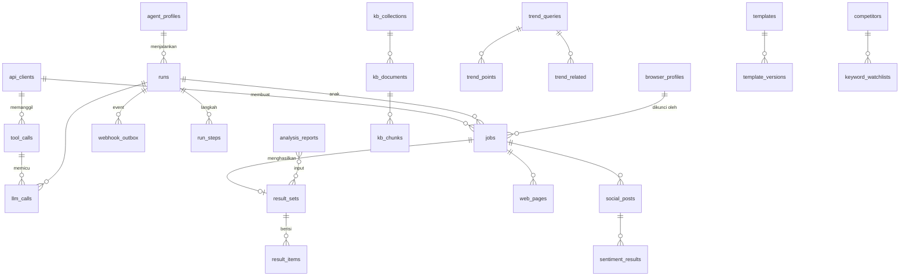

# Database — MCP Marketing

## 1. Prinsip

| Prinsip | Detail |
|---|---|
| Satu server, dua schema | Database `marketing_dashboard` (PostgreSQL ≥ 16; Dashboard memakai 17). Schema `public` = milik Dashboard (Prisma). Schema **`mcp`** = milik MCP (Alembic, `version_table_schema = mcp`) |
| Least privilege | Role `mcp_app` (runtime): `SELECT` **berkolom** pada tabel `public` yang dibutuhkan (tanpa `users.email`, `users.password_hash`, `refresh_tokens`), hak penuh DML di schema `mcp`. Role `mcp_owner`: pemilik schema `mcp`, hanya untuk migrasi |
| Tidak menulis ke `public` | Perubahan data inti lewat webhook/Service API (README D4) |
| Waktu | Semua `timestamptz` UTC; tanggal kalender `date` |
| ID | `uuid` (`gen_random_uuid()`), kecuali handle/job/report yang memakai ID pendek ber-prefix (teks) agar hemat token saat dikirim ke LLM |
| Data besar | Hasil list disimpan di `result_sets`/`result_items` (handle) dan tabel domain (`social_posts`, `web_pages`, `trend_points`) |
| Retensi | Dijalankan scheduler harian (TASK-07/24): lihat §6 |

## 2. ERD



## 3. Bootstrap (sekali, sebagai superuser) — `scripts/sql/bootstrap.sql`

```sql
CREATE EXTENSION IF NOT EXISTS vector;          -- pgvector >= 0.7
CREATE EXTENSION IF NOT EXISTS pgcrypto;        -- gen_random_uuid (sudah dipakai Dashboard)

CREATE ROLE mcp_owner LOGIN PASSWORD :'owner_pw';
CREATE ROLE mcp_app   LOGIN PASSWORD :'app_pw';

CREATE SCHEMA IF NOT EXISTS mcp AUTHORIZATION mcp_owner;
GRANT USAGE ON SCHEMA mcp TO mcp_app;
ALTER DEFAULT PRIVILEGES FOR ROLE mcp_owner IN SCHEMA mcp
  GRANT SELECT, INSERT, UPDATE, DELETE ON TABLES TO mcp_app;
ALTER DEFAULT PRIVILEGES FOR ROLE mcp_owner IN SCHEMA mcp
  GRANT USAGE, SELECT ON SEQUENCES TO mcp_app;

-- Akses baca ke data Dashboard (schema public), berkolom
GRANT USAGE ON SCHEMA public TO mcp_app;
GRANT SELECT (id, username, display_name, avatar_url, is_active) ON public.users TO mcp_app;
GRANT SELECT ON public.workspaces, public.workspace_members, public.agents, public.projects,
               public.tasks, public.document_blocks, public.comments, public.activity_logs,
               public.agent_runs TO mcp_app;
-- TIDAK diberikan: refresh_tokens, notifications, mcp_webhook_events, users.email, users.password_hash

ALTER ROLE mcp_app SET search_path = mcp, public;
ALTER ROLE mcp_app SET statement_timeout = '30s';
ALTER ROLE mcp_app SET idle_in_transaction_session_timeout = '60s';
```

> Bila tabel `public` baru ditambahkan Dashboard, grant harus ditambah manual (didokumentasikan di `docs/operations.md`). Test `test_grants.py` memastikan `mcp_app` **tidak** bisa membaca `users.email`.

## 4. DDL Schema `mcp`

### 4.1 Klien, audit & pemakaian

```sql
CREATE TABLE mcp.api_clients (
  id                  uuid PRIMARY KEY DEFAULT gen_random_uuid(),
  name                varchar(100) NOT NULL UNIQUE,
  kind                varchar(16)  NOT NULL DEFAULT 'external' CHECK (kind IN ('system','external','agent')),
  key_prefix          varchar(8)   NOT NULL UNIQUE,
  key_hash            char(64)     NOT NULL,
  toolsets            text[]       NOT NULL DEFAULT '{}',
  is_admin            boolean      NOT NULL DEFAULT false,
  dashboard_agent_id  uuid,                         -- aktor di Service API (public.agents.id)
  workspace_id        uuid,                         -- batas akses data Dashboard
  daily_token_budget  integer      CHECK (daily_token_budget IS NULL OR daily_token_budget > 0),
  rpm_limit           integer      NOT NULL DEFAULT 120,
  status              varchar(16)  NOT NULL DEFAULT 'active' CHECK (status IN ('active','revoked')),
  expires_at          timestamptz,
  last_used_at        timestamptz,
  created_at          timestamptz  NOT NULL DEFAULT now(),
  updated_at          timestamptz  NOT NULL DEFAULT now()
);

CREATE TABLE mcp.tool_calls (
  id             uuid PRIMARY KEY DEFAULT gen_random_uuid(),
  request_id     varchar(64)  NOT NULL,
  client_id      uuid REFERENCES mcp.api_clients(id),
  run_id         uuid,                               -- run Dashboard (bila ada)
  tool           varchar(64)  NOT NULL,
  args_hash      char(64)     NOT NULL,
  args_preview   jsonb        NOT NULL DEFAULT '{}', -- argumen dipotong/disamarkan (maks 2 KB)
  status         varchar(16)  NOT NULL CHECK (status IN ('ok','error','cached','job')),
  error_code     varchar(48),
  duration_ms    integer      NOT NULL,
  output_tokens  integer      NOT NULL DEFAULT 0,    -- estimasi token output ke LLM pemanggil
  baseline_tokens integer,                           -- estimasi token jika data mentah dikirim (T-eval)
  llm_tokens     integer      NOT NULL DEFAULT 0,    -- total token LLM internal yang dipakai tool
  job_id         varchar(16),
  created_at     timestamptz  NOT NULL DEFAULT now()
);
CREATE INDEX tool_calls_created_idx ON mcp.tool_calls (created_at DESC);
CREATE INDEX tool_calls_tool_idx    ON mcp.tool_calls (tool, created_at DESC);
CREATE INDEX tool_calls_run_idx     ON mcp.tool_calls (run_id) WHERE run_id IS NOT NULL;

CREATE TABLE mcp.llm_calls (
  id                uuid PRIMARY KEY DEFAULT gen_random_uuid(),
  tool_call_id      uuid REFERENCES mcp.tool_calls(id) ON DELETE SET NULL,
  run_id            uuid,
  client_id         uuid,
  purpose           varchar(32)  NOT NULL,            -- classify, strategy, agent_loop, embed, ...
  route             varchar(64)  NOT NULL,            -- fast, smart, embed-default
  model_resolved    varchar(128),                     -- dari respons Gateway
  gateway_request_id varchar(64),
  prompt_tokens     integer NOT NULL DEFAULT 0,
  completion_tokens integer NOT NULL DEFAULT 0,
  cached            boolean NOT NULL DEFAULT false,
  cost_usd          numeric(12,6),
  latency_ms        integer NOT NULL,
  status            varchar(16) NOT NULL CHECK (status IN ('ok','error')),
  error_code        varchar(48),
  created_at        timestamptz NOT NULL DEFAULT now()
);
CREATE INDEX llm_calls_created_idx ON mcp.llm_calls (created_at DESC);
CREATE INDEX llm_calls_run_idx     ON mcp.llm_calls (run_id) WHERE run_id IS NOT NULL;

CREATE TABLE mcp.usage_daily (            -- rollup, tidak pernah dihapus
  day            date        NOT NULL,
  client_id      uuid        NOT NULL,
  tool           varchar(64) NOT NULL,
  calls          integer     NOT NULL DEFAULT 0,
  errors         integer     NOT NULL DEFAULT 0,
  cache_hits     integer     NOT NULL DEFAULT 0,
  output_tokens  bigint      NOT NULL DEFAULT 0,
  baseline_tokens bigint     NOT NULL DEFAULT 0,
  llm_tokens     bigint      NOT NULL DEFAULT 0,
  cost_usd       numeric(14,6) NOT NULL DEFAULT 0,
  external_units bigint      NOT NULL DEFAULT 0,   -- mis. post X yang dibaca (biaya API)
  PRIMARY KEY (day, client_id, tool)
);

CREATE TABLE mcp.cache_entries (
  cache_key   char(64)    PRIMARY KEY,           -- sha256(tool|version|args ternormalisasi) / prompt LLM
  namespace   varchar(32) NOT NULL,              -- tool | llm | embed
  value       jsonb       NOT NULL,
  size_bytes  integer     NOT NULL,
  hits        integer     NOT NULL DEFAULT 0,
  expires_at  timestamptz NOT NULL,
  created_at  timestamptz NOT NULL DEFAULT now()
);
CREATE INDEX cache_expires_idx ON mcp.cache_entries (expires_at);

CREATE TABLE mcp.embedding_cache (
  text_sha256 char(64)    NOT NULL,
  model       varchar(64) NOT NULL,
  dim         smallint    NOT NULL,
  embedding   vector      NOT NULL,
  created_at  timestamptz NOT NULL DEFAULT now(),
  PRIMARY KEY (text_sha256, model)
);
```

### 4.2 Handle & job

```sql
CREATE TABLE mcp.result_sets (
  handle       varchar(16) PRIMARY KEY,           -- h_xxxxxxxxxx
  kind         varchar(32) NOT NULL,              -- social_posts, web_pages, trend_points, db_rows, sentiment, ...
  client_id    uuid,
  run_id       uuid,
  job_id       varchar(16),
  columns      text[]      NOT NULL,
  total        integer     NOT NULL DEFAULT 0,
  stats        jsonb       NOT NULL DEFAULT '{}',
  source_ref   jsonb       NOT NULL DEFAULT '{}', -- mis. {"table":"social_posts","job_id":"j_…"}
  expires_at   timestamptz NOT NULL,
  created_at   timestamptz NOT NULL DEFAULT now()
);

CREATE TABLE mcp.result_items (
  handle     varchar(16) NOT NULL REFERENCES mcp.result_sets(handle) ON DELETE CASCADE,
  idx        integer     NOT NULL,
  ref_id     uuid,                                -- id di tabel domain (bila ada)
  data       jsonb       NOT NULL,                -- baris terproyeksi
  sort_ts    timestamptz,
  sort_num   double precision,
  PRIMARY KEY (handle, idx)
);
CREATE INDEX result_items_ts_idx  ON mcp.result_items (handle, sort_ts);
CREATE INDEX result_items_num_idx ON mcp.result_items (handle, sort_num DESC);

CREATE TABLE mcp.jobs (
  id             varchar(16) PRIMARY KEY,          -- j_xxxxxxxxxx
  kind           varchar(32) NOT NULL,             -- web_scrape, web_crawl, x_search, threads_search, trends, kb_ingest, sentiment, market, dm, kb_sync
  status         varchar(16) NOT NULL DEFAULT 'queued'
                 CHECK (status IN ('queued','running','succeeded','failed','cancelled')),
  priority       smallint    NOT NULL DEFAULT 5,
  params         jsonb       NOT NULL,
  client_id      uuid,
  run_id         uuid,                             -- run Dashboard yang memicu (untuk cancel berantai)
  parent_job_id  varchar(16) REFERENCES mcp.jobs(id),
  browser_profile_id uuid,
  progress_done  integer     NOT NULL DEFAULT 0,
  progress_total integer,
  checkpoint     jsonb       NOT NULL DEFAULT '{}',-- untuk resume (mis. hari terakhir yang selesai)
  result_handle  varchar(16),
  result         jsonb,                            -- ringkasan akhir (envelope tanpa items)
  error          jsonb,
  attempts       smallint    NOT NULL DEFAULT 0,
  max_attempts   smallint    NOT NULL DEFAULT 3,
  run_after      timestamptz NOT NULL DEFAULT now(),
  locked_by      varchar(64),
  locked_at      timestamptz,
  heartbeat_at   timestamptz,
  timeout_s      integer     NOT NULL DEFAULT 1800,
  cancel_requested boolean   NOT NULL DEFAULT false,
  started_at     timestamptz,
  finished_at    timestamptz,
  created_at     timestamptz NOT NULL DEFAULT now()
);
CREATE INDEX jobs_pick_idx ON mcp.jobs (priority, run_after) WHERE status = 'queued';
CREATE INDEX jobs_run_idx  ON mcp.jobs (run_id) WHERE run_id IS NOT NULL;

CREATE TABLE mcp.schedules (
  id          uuid PRIMARY KEY DEFAULT gen_random_uuid(),
  name        varchar(100) NOT NULL UNIQUE,
  cron        varchar(64)  NOT NULL,               -- zona waktu TIMEZONE
  job_kind    varchar(32)  NOT NULL,
  params      jsonb        NOT NULL DEFAULT '{}',
  is_enabled  boolean      NOT NULL DEFAULT true,
  last_run_at timestamptz,
  next_run_at timestamptz
);
```

### 4.3 Agent run & outbox (kontrak Dashboard)

```sql
CREATE TABLE mcp.agent_profiles (
  agent_key      varchar(100) PRIMARY KEY,          -- = public.agents.mcp_agent_key
  display_name   varchar(100) NOT NULL,
  system_prompt  text         NOT NULL,
  route          varchar(64)  NOT NULL DEFAULT 'smart',
  toolsets       text[]       NOT NULL,
  tool_denylist  text[]       NOT NULL DEFAULT '{}',
  run_token_budget integer    NOT NULL DEFAULT 120000,
  max_steps      smallint     NOT NULL DEFAULT 25,
  is_active      boolean      NOT NULL DEFAULT true,
  version        integer      NOT NULL DEFAULT 1,
  updated_at     timestamptz  NOT NULL DEFAULT now()
);

CREATE TABLE mcp.runs (
  run_id          uuid PRIMARY KEY,                 -- dari Dashboard
  mcp_run_id      varchar(32) NOT NULL UNIQUE,      -- mr_xxxxxxxxxx
  trigger         varchar(16) NOT NULL CHECK (trigger IN ('assignment','mention','prompt_block')),
  agent_key       varchar(100) NOT NULL REFERENCES mcp.agent_profiles(agent_key),
  agent_id        uuid        NOT NULL,
  workspace_id    uuid,
  project_id      uuid        NOT NULL,
  task_id         uuid,
  status          varchar(24) NOT NULL DEFAULT 'accepted'
                  CHECK (status IN ('accepted','running','completed','failed','cancelled','cancelled_by_dashboard')),
  input           jsonb       NOT NULL,              -- payload dispatch (context_blocks dipangkas)
  callback        jsonb       NOT NULL,
  tokens_used     integer     NOT NULL DEFAULT 0,
  token_budget    integer     NOT NULL,
  steps           smallint    NOT NULL DEFAULT 0,
  cancel_requested boolean    NOT NULL DEFAULT false,
  cancel_reason   varchar(32),
  error           jsonb,
  summary         text,
  subtask_refs    jsonb       NOT NULL DEFAULT '{}', -- client_ref -> task_id dari respons webhook
  last_event_at   timestamptz,
  started_at      timestamptz,
  finished_at     timestamptz,
  created_at      timestamptz NOT NULL DEFAULT now()
);
CREATE INDEX runs_status_idx ON mcp.runs (status) WHERE status IN ('accepted','running');

CREATE TABLE mcp.run_steps (
  run_id      uuid     NOT NULL REFERENCES mcp.runs(run_id) ON DELETE CASCADE,
  step        smallint NOT NULL,
  role        varchar(16) NOT NULL,                 -- assistant | tool | summary
  tool        varchar(64),
  content     jsonb    NOT NULL,                    -- sudah dipadatkan (bukan data mentah)
  tokens      integer  NOT NULL DEFAULT 0,
  created_at  timestamptz NOT NULL DEFAULT now(),
  PRIMARY KEY (run_id, step)
);

CREATE TABLE mcp.webhook_outbox (
  id              bigserial PRIMARY KEY,            -- urutan global; urutan per run = (run_id, seq)
  event_id        uuid        NOT NULL UNIQUE,
  run_id          uuid        NOT NULL REFERENCES mcp.runs(run_id),
  seq             integer     NOT NULL,
  event_type      varchar(48) NOT NULL,
  payload         jsonb       NOT NULL,             -- envelope lengkap contract 1.0
  status          varchar(16) NOT NULL DEFAULT 'pending'
                  CHECK (status IN ('pending','sending','delivered','duplicate','failed','discarded')),
  attempts        smallint    NOT NULL DEFAULT 0,
  next_attempt_at timestamptz NOT NULL DEFAULT now(),
  first_attempt_at timestamptz,
  last_http_status smallint,
  last_error      text,
  response        jsonb,                            -- result dari Dashboard (applied/conflicts/created)
  delivered_at    timestamptz,
  created_at      timestamptz NOT NULL DEFAULT now(),
  UNIQUE (run_id, seq)
);
CREATE INDEX outbox_pending_idx ON mcp.webhook_outbox (next_attempt_at) WHERE status IN ('pending','sending');
```

### 4.4 Template Notion

```sql
CREATE TABLE mcp.templates (
  key          varchar(64) PRIMARY KEY,             -- content_calendar_3w, campaign_brief, ...
  name         varchar(150) NOT NULL,
  category     varchar(32)  NOT NULL,
  description  text,
  origin       varchar(16)  NOT NULL DEFAULT 'seed' CHECK (origin IN ('seed','generated','custom')),
  current_version integer   NOT NULL DEFAULT 1,
  workspace_id uuid,                                -- null = global
  is_active    boolean      NOT NULL DEFAULT true,
  created_by_client uuid,
  created_at   timestamptz  NOT NULL DEFAULT now(),
  updated_at   timestamptz  NOT NULL DEFAULT now()
);

CREATE TABLE mcp.template_versions (
  template_key varchar(64) NOT NULL REFERENCES mcp.templates(key) ON DELETE CASCADE,
  version      integer     NOT NULL,
  variables    jsonb       NOT NULL DEFAULT '[]',   -- [{name, type, required, default, description}]
  blocks       jsonb       NOT NULL,                -- [{block_type, content_json, children?}] dengan {{var}}
  subtasks     jsonb       NOT NULL DEFAULT '[]',   -- [{client_ref, title, offset_days, duration_days, tags, blocks, children}]
  outline      jsonb       NOT NULL,                -- cache outline hemat token
  created_at   timestamptz NOT NULL DEFAULT now(),
  PRIMARY KEY (template_key, version)
);
```

### 4.5 Browser & web

```sql
CREATE TABLE mcp.browser_profiles (
  id             uuid PRIMARY KEY DEFAULT gen_random_uuid(),
  name           varchar(64)  NOT NULL UNIQUE,
  purpose        varchar(200),
  user_data_dir  text         NOT NULL,             -- BROWSER_PROFILES_DIR/<name>
  profile_directory varchar(64) NOT NULL DEFAULT 'Default',
  user_agent     text,
  window_size    varchar(16)  NOT NULL DEFAULT '1366,900',
  proxy_url_env  varchar(64),                       -- NAMA env berisi proxy (bukan nilainya)
  headless       boolean      NOT NULL DEFAULT false,
  allowed_sites  text[]       NOT NULL DEFAULT '{}',-- mis. {x.com, threads.net, trends.google.com}
  login_status   jsonb        NOT NULL DEFAULT '{}',-- {"x.com": {"ok":true,"checked_at":"…"}}
  locked_by_job  varchar(16),
  locked_at      timestamptz,
  last_used_at   timestamptz,
  is_active      boolean      NOT NULL DEFAULT true,
  created_at     timestamptz  NOT NULL DEFAULT now()
);

CREATE TABLE mcp.web_pages (
  id            uuid PRIMARY KEY DEFAULT gen_random_uuid(),
  job_id        varchar(16) REFERENCES mcp.jobs(id) ON DELETE SET NULL,
  url           text        NOT NULL,
  final_url     text,
  domain        varchar(255) NOT NULL,
  status        varchar(24) NOT NULL,               -- ok, http_error, skipped_robots, blocked, timeout, ssrf_denied
  http_status   smallint,
  title         text,
  published_at  timestamptz,
  content_md    text,                               -- markdown hasil ekstraksi (maks 200 KB)
  extracted     jsonb,                              -- hasil selectors / web_extract
  content_hash  char(64),
  chars         integer     NOT NULL DEFAULT 0,
  fetched_at    timestamptz NOT NULL DEFAULT now()
);
CREATE INDEX web_pages_job_idx    ON mcp.web_pages (job_id);
CREATE INDEX web_pages_url_idx    ON mcp.web_pages (url, fetched_at DESC);
```

### 4.6 Sosial media & trends

```sql
CREATE TABLE mcp.social_posts (
  id             uuid PRIMARY KEY DEFAULT gen_random_uuid(),
  source         varchar(16)  NOT NULL CHECK (source IN ('x','threads')),
  external_id    varchar(64)  NOT NULL,
  url            text,
  author_handle  varchar(100),
  author_id      varchar(64),
  author_followers integer,
  text           text         NOT NULL,
  lang           varchar(8),
  posted_at      timestamptz  NOT NULL,
  is_reply       boolean      NOT NULL DEFAULT false,
  is_repost      boolean      NOT NULL DEFAULT false,
  likes          integer      NOT NULL DEFAULT 0,
  replies        integer      NOT NULL DEFAULT 0,
  reposts        integer      NOT NULL DEFAULT 0,
  quotes         integer      NOT NULL DEFAULT 0,
  views          bigint,
  hashtags       text[]       NOT NULL DEFAULT '{}',
  mentions       text[]       NOT NULL DEFAULT '{}',
  media_type     varchar(16),
  provider       varchar(16)  NOT NULL,             -- x_api, browser, threads_api
  raw            jsonb,                             -- opsional (APP_ENV=dev), dihapus oleh retensi
  first_seen_job varchar(16),
  collected_at   timestamptz  NOT NULL DEFAULT now(),
  text_tsv       tsvector GENERATED ALWAYS AS (to_tsvector('simple', text)) STORED,
  UNIQUE (source, external_id)
);
CREATE INDEX social_posts_time_idx ON mcp.social_posts (source, posted_at DESC);
CREATE INDEX social_posts_tsv_idx  ON mcp.social_posts USING gin (text_tsv);
CREATE INDEX social_posts_tags_idx ON mcp.social_posts USING gin (hashtags);

CREATE TABLE mcp.job_posts (              -- relasi job ↔ post (satu post bisa ditemukan banyak job)
  job_id   varchar(16) NOT NULL REFERENCES mcp.jobs(id) ON DELETE CASCADE,
  post_id  uuid        NOT NULL REFERENCES mcp.social_posts(id) ON DELETE CASCADE,
  matched_keywords text[] NOT NULL DEFAULT '{}',
  PRIMARY KEY (job_id, post_id)
);

CREATE TABLE mcp.trend_queries (
  id          uuid PRIMARY KEY DEFAULT gen_random_uuid(),
  kind        varchar(16) NOT NULL CHECK (kind IN ('interest','region','related')),
  keywords    text[]      NOT NULL,
  geo         varchar(16) NOT NULL DEFAULT 'ID',
  start_date  date        NOT NULL,
  end_date    date        NOT NULL,
  category    integer     NOT NULL DEFAULT 0,
  gprop       varchar(16) NOT NULL DEFAULT 'web',
  resolution  varchar(8),                            -- day | week | month (dari Google)
  provider    varchar(16) NOT NULL,
  params_hash char(64)    NOT NULL,
  fetched_at  timestamptz NOT NULL DEFAULT now()
);
CREATE INDEX trend_queries_hash_idx ON mcp.trend_queries (params_hash, fetched_at DESC);

CREATE TABLE mcp.trend_points (
  query_id   uuid        NOT NULL REFERENCES mcp.trend_queries(id) ON DELETE CASCADE,
  keyword    text        NOT NULL,
  bucket     date,                                   -- interest over time
  region     varchar(100),                           -- by region
  value      smallint    NOT NULL CHECK (value BETWEEN 0 AND 100),
  is_partial boolean     NOT NULL DEFAULT false
);
CREATE INDEX trend_points_q_idx ON mcp.trend_points (query_id, keyword, bucket);

CREATE TABLE mcp.trend_related (
  query_id   uuid        NOT NULL REFERENCES mcp.trend_queries(id) ON DELETE CASCADE,
  keyword    text        NOT NULL,
  kind       varchar(8)  NOT NULL CHECK (kind IN ('query','topic')),
  rank_type  varchar(8)  NOT NULL CHECK (rank_type IN ('top','rising')),
  term       text        NOT NULL,
  value      integer,                                -- rising: % (Breakout = 5000)
  position   smallint    NOT NULL
);
```

### 4.7 NLP, laporan, data master marketing

```sql
CREATE TABLE mcp.sentiment_results (
  id           uuid PRIMARY KEY DEFAULT gen_random_uuid(),
  target_type  varchar(16) NOT NULL CHECK (target_type IN ('social_post','web_page','text')),
  target_id    uuid,                                 -- null untuk teks ad-hoc
  text_sha256  char(64)    NOT NULL,
  method       varchar(16) NOT NULL CHECK (method IN ('model','llm','hybrid')),
  model        varchar(100) NOT NULL,
  label        varchar(8)  NOT NULL CHECK (label IN ('positive','neutral','negative')),
  score        real        NOT NULL,
  aspects      jsonb       NOT NULL DEFAULT '[]',    -- [{aspect, label, score}]
  lang         varchar(8),
  created_at   timestamptz NOT NULL DEFAULT now(),
  UNIQUE (text_sha256, model)                         -- cache: teks sama tidak dianalisis ulang
);
CREATE INDEX sentiment_target_idx ON mcp.sentiment_results (target_type, target_id);

CREATE TABLE mcp.analysis_reports (
  id            varchar(16) PRIMARY KEY,              -- r_xxxxxxxxxx
  kind          varchar(24) NOT NULL CHECK (kind IN ('sentiment','market','campaign_plan','campaign_eval','digital_strategy')),
  title         varchar(200) NOT NULL,
  subject       text,
  params        jsonb       NOT NULL,
  input_handles text[]      NOT NULL DEFAULT '{}',
  key_numbers   jsonb       NOT NULL DEFAULT '{}',
  summary       text        NOT NULL,                 -- ≤ 8 bullet
  content       jsonb       NOT NULL,                 -- {sections:[{id, title, blocks|data}]}
  language      varchar(8)  NOT NULL DEFAULT 'id',
  llm_tokens    integer     NOT NULL DEFAULT 0,
  workspace_id  uuid,
  project_id    uuid,
  task_id       uuid,
  run_id        uuid,
  client_id     uuid,
  published_to  jsonb       NOT NULL DEFAULT '[]',    -- [{type, id, at}]
  created_at    timestamptz NOT NULL DEFAULT now()
);
CREATE INDEX reports_project_idx ON mcp.analysis_reports (project_id, created_at DESC);

CREATE TABLE mcp.competitors (            -- entitas rw untuk db_* tools
  id           uuid PRIMARY KEY DEFAULT gen_random_uuid(),
  workspace_id uuid,
  name         varchar(150) NOT NULL,
  website      text,
  social       jsonb        NOT NULL DEFAULT '{}',   -- {"x":"@...", "threads":"@...", "instagram":"@..."}
  keywords     text[]       NOT NULL DEFAULT '{}',
  notes        text,
  created_at   timestamptz  NOT NULL DEFAULT now(),
  updated_at   timestamptz  NOT NULL DEFAULT now(),
  deleted_at   timestamptz,
  UNIQUE (workspace_id, name)
);

CREATE TABLE mcp.keyword_watchlists (
  id            uuid PRIMARY KEY DEFAULT gen_random_uuid(),
  workspace_id  uuid,
  name          varchar(150) NOT NULL,
  competitor_id uuid REFERENCES mcp.competitors(id) ON DELETE SET NULL,
  keywords      text[]       NOT NULL,
  sources       text[]       NOT NULL DEFAULT '{x,threads,trends}',
  schedule_id   uuid REFERENCES mcp.schedules(id) ON DELETE SET NULL,  -- crawl berkala opsional
  created_at    timestamptz  NOT NULL DEFAULT now(),
  updated_at    timestamptz  NOT NULL DEFAULT now(),
  deleted_at    timestamptz
);
```

### 4.8 Vector DB (pgvector)

```sql
CREATE TABLE mcp.kb_collections (
  id           uuid PRIMARY KEY DEFAULT gen_random_uuid(),
  name         varchar(150) NOT NULL,
  description  text,
  workspace_id uuid,
  project_id   uuid,                                 -- koleksi "dashboard:<project_id>"
  embed_model  varchar(64) NOT NULL,                 -- embed-default | local/multilingual-e5-small
  embed_dim    smallint    NOT NULL CHECK (embed_dim IN (384, 768, 1024, 1536)),
  created_at   timestamptz NOT NULL DEFAULT now(),
  UNIQUE (workspace_id, name)
);

CREATE TABLE mcp.kb_documents (
  id            uuid PRIMARY KEY DEFAULT gen_random_uuid(),
  collection_id uuid NOT NULL REFERENCES mcp.kb_collections(id) ON DELETE CASCADE,
  source_type   varchar(24) NOT NULL,                -- text, url, handle, report, dashboard_block, dashboard_task
  source_ref    text        NOT NULL,                -- url / handle / block_id / task_id
  source_version integer,                            -- document_blocks.version untuk sinkron inkremental
  title         text,
  metadata      jsonb       NOT NULL DEFAULT '{}',
  content_hash  char(64)    NOT NULL,
  created_at    timestamptz NOT NULL DEFAULT now(),
  updated_at    timestamptz NOT NULL DEFAULT now(),
  UNIQUE (collection_id, source_type, source_ref)
);

CREATE TABLE mcp.kb_chunks (
  id           uuid PRIMARY KEY DEFAULT gen_random_uuid(),
  document_id  uuid     NOT NULL REFERENCES mcp.kb_documents(id) ON DELETE CASCADE,
  collection_id uuid    NOT NULL,                    -- denormalisasi untuk filter cepat
  chunk_index  integer  NOT NULL,
  text         text     NOT NULL,
  tokens       integer  NOT NULL,
  embed_dim    smallint NOT NULL,
  embedding    vector   NOT NULL,                    -- dimensi divalidasi = kb_collections.embed_dim
  metadata     jsonb    NOT NULL DEFAULT '{}',
  text_tsv     tsvector GENERATED ALWAYS AS (to_tsvector('simple', text)) STORED,
  UNIQUE (document_id, chunk_index)
);
-- Indeks HNSW parsial per dimensi (kolom vector tanpa dimensi tetap → indeks ekspresi ber-cast)
CREATE INDEX kb_chunks_hnsw_1536 ON mcp.kb_chunks
  USING hnsw ((embedding::vector(1536)) vector_cosine_ops) WHERE embed_dim = 1536;
CREATE INDEX kb_chunks_hnsw_384 ON mcp.kb_chunks
  USING hnsw ((embedding::vector(384)) vector_cosine_ops) WHERE embed_dim = 384;
CREATE INDEX kb_chunks_tsv_idx  ON mcp.kb_chunks USING gin (text_tsv);
CREATE INDEX kb_chunks_coll_idx ON mcp.kb_chunks (collection_id);
```

Query vector **wajib** memakai ekspresi yang sama agar indeks terpakai:

```sql
SELECT id, text, 1 - ((embedding::vector(1536)) <=> $1::vector(1536)) AS score
FROM mcp.kb_chunks
WHERE embed_dim = 1536 AND collection_id = $2
ORDER BY (embedding::vector(1536)) <=> $1::vector(1536)
LIMIT 30;
```

## 5. Entitas untuk Tool `db_*` (whitelist)

| Entitas | Tabel | Akses | Field yang dapat dibaca (ringkas) |
|---|---|---|---|
| `workspaces` | public.workspaces | r | id, name, timezone |
| `members` | public.workspace_members ⨝ users | r | workspace_id, user_id, display_name, role |
| `agents` | public.agents | r | id, name, handle, mcp_agent_key, is_active |
| `projects` | public.projects | r | id, workspace_id, title, description, created_at |
| `tasks` | public.tasks | r | id, project_id, parent_task_id, depth, title, status, priority, assignee_type, start_date, end_date, is_milestone, tags, agent_status, completed_at |
| `blocks` | public.document_blocks | r | id, project_id, task_id, block_type, plain_text, version, updated_at |
| `comments` | public.comments | r | id, project_id, entity_type, entity_id, author_type, content, created_at |
| `activity` | public.activity_logs | r | id, project_id, entity_type, action, actor_type, created_at |
| `competitors` | mcp.competitors | rw | semua |
| `watchlists` | mcp.keyword_watchlists | rw | semua |
| `reports` | mcp.analysis_reports | r (+ delete) | id, kind, title, summary, key_numbers, created_at |
| `templates` | mcp.templates | r | key, name, category, origin |
| `social_posts` | mcp.social_posts | r | source, posted_at, author_handle, text, likes, replies, reposts |
| `kb_collections` | mcp.kb_collections | rw | semua |

Semua query entitas Dashboard otomatis difilter `deleted_at IS NULL` dan dibatasi `workspace_id` milik klien (`api_clients.workspace_id`) bila diisi.

## 6. Retensi & Pemeliharaan

| Data | Retensi default | Env |
|---|---|---|
| `tool_calls`, `llm_calls` | 180 hari (rollup ke `usage_daily` dulu) | `AUDIT_RETENTION_DAYS` |
| `result_sets/items` | 30 hari (atau `expires_at`) | `RESULT_TTL_DAYS` |
| `cache_entries` | sesuai `expires_at`, dibersihkan tiap jam | — |
| `social_posts.raw` | 14 hari (kolom di-NULL-kan) | `RAW_RETENTION_DAYS` |
| `social_posts`, `web_pages` | 180 hari kecuali dirujuk laporan / KB | `SOCIAL_RETENTION_DAYS` |
| `webhook_outbox` delivered | 30 hari | — |
| `run_steps` | 90 hari | — |
| `analysis_reports`, `templates`, `kb_*`, `usage_daily` | tidak dihapus otomatis | — |

Backup memakai backup database Dashboard (schema `mcp` ikut ter-backup). `VACUUM (ANALYZE)` mingguan untuk `kb_chunks` & `social_posts`.

## 6a. Catatan Implementasi (v0.1.0-dev)

| Perbedaan | Alasan |
|---|---|
| `embedding_cache` & `kb_chunks` (+ indeks HNSW) ada di revisi **`0002_kb_vector`**, bukan `0001_init` | schema inti tetap bisa dipasang di server tanpa pgvector; `manage.py migrate` berhenti di `0001_init` bila ekstensi belum ada |
| `mcp.jobs` + kolom `dedupe_key char(64)`, `estimate jsonb`, `message varchar(300)`; indeks `jobs_dedupe_idx`, `jobs_parent_idx` | dedupe job identik, estimasi untuk `JobAccepted`, pesan progres; pencarian turunan untuk cancel berantai |
| Trigger `jobs_notify_done` → `pg_notify('mcp_job_done', id)` | `job_wait` memakai LISTEN/NOTIFY |
| Indeks `runs_task_mention_idx (task_id, created_at) WHERE trigger = 'mention'` | batas 10 run mention per task per jam |
| `run_steps.step` = nomor urut baris per run (assistant/tool/summary/user) | satu langkah LLM menghasilkan beberapa baris; jumlah langkah = baris `assistant` |
| `bootstrap.sql` menerima `-v owner_role=… -v app_role=…` | test integrasi memakai role terpisah (`*_test`) agar tidak mengubah password role asli |

## 7. Model Baca (`public`) di Python

Model SQLAlchemy untuk tabel `public` didefinisikan **manual** (bukan autogenerate) di `mcp_marketing/models/dashboard.py`, ditandai `info={"readonly": True}` dan dikecualikan dari Alembic (`include_object` hanya schema `mcp`). Perubahan schema Prisma yang memengaruhi kolom terpakai dideteksi oleh test `test_dashboard_schema_compat.py` (membandingkan kolom yang diharapkan dengan `information_schema`).
