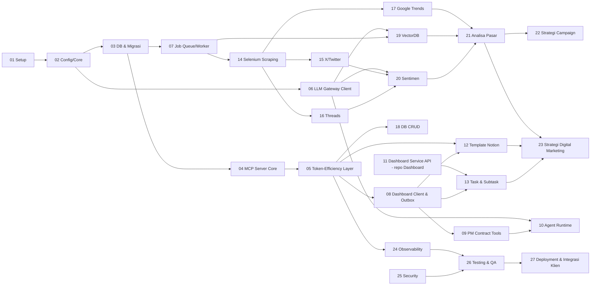

# MCP Marketing (Project 2) — Index Dokumen, Urutan Kerja & Keputusan Teknis

> Pintu masuk dokumentasi **Custom MCP Server** yang menghubungkan **LLM Gateway** (`llm-genai`) dan **Marketing Dashboard JTP** (`marketingdashboardjtp`).
> Versi dokumen: **1.0** · Tanggal: 30 Oktober 2026 · Status: Draft — menunggu review.

---

## 1. Ringkasan

MCP Marketing adalah server **Model Context Protocol** (Python 3.11) yang berperan ganda:

1. **Implementasi "Project 2"** dari kontrak `M1_MCP_INTEGRATION.md` (contract 1.0) milik Dashboard: menerima `pm_*` tool call dari Dashboard, menjalankan AI Agent (`strategist`, `researcher`, …), dan mengirim hasil kerja agent lewat webhook HMAC.
2. **Toolbox marketing untuk Agentic AI** — dipakai oleh agent internal maupun klien MCP lain (Claude Desktop, Cursor, Cline, dll.): template Notion-like, task & subtask, scraping Selenium, crawling X/Twitter, Threads, Google Trends, CRUD database Dashboard, vector DB, analisis sentimen, analisis pasar, strategi campaign, dan strategi digital marketing.

Prinsip utamanya: **menghemat token LLM** (lokal maupun API eksternal). Pekerjaan yang bisa dilakukan oleh kode (crawling, agregasi, statistik, klasifikasi model kecil) dikerjakan di server; LLM hanya menerima **ringkasan padat + handle** ke data lengkap. Semua panggilan LLM lewat **LLM Gateway** sehingga pemilihan model (lokal/remote), fallback, kuota, dan biaya tercatat di satu tempat.

```
                       ┌──────────────────────────── MCP Marketing :4100 ───────────────────────────┐
 Dashboard (NestJS) ──►│ /mcp  (Streamable HTTP)                                                    │
  pm_* tools           │  ├─ Toolset registry + Token-efficiency layer (handle, cache, budget)      │
 Claude Desktop/IDE ──►│  ├─ Agent Runtime (strategist, researcher, …) ── tool calling ──┐          │
                       │  ├─ Worker (job queue Postgres) ── Selenium/Chrome profile       │          │
 Dashboard ◄─ webhook ─│  └─ Outbox webhook (HMAC, berurutan per run)                     │          │
                       └──────────┬──────────────────────┬───────────────────────────────┼──────────┘
                                  │                      │                               ▼
                    PostgreSQL marketing_dashboard   Dashboard Agent API /       LLM Gateway :8000
                    ├─ schema public (Prisma, R/O)   Service API (REST)          /v1/chat/completions
                    └─ schema mcp (Alembic, R/W,                                 /v1/embeddings
                       pgvector)                                                 (route fast/smart/embed-default)
```

## 2. Peta Dokumen

| Dokumen | Isi | Pembaca utama |
|---|---|---|
| [PRD.md](PRD.md) | Visi, scope, persona, requirement fungsional & non-fungsional, metrik penghematan token | Semua |
| [ARCHITECTURE.md](ARCHITECTURE.md) | Tech stack (versi Python mengikuti LLM Gateway), struktur repo, alur data, env vars, cara menjalankan | Dev, DevOps |
| [MCP_SPEC.md](MCP_SPEC.md) | Katalog lengkap MCP tools (input/output), pola hemat token, kontrak dengan Dashboard & Gateway | Dev, tim Dashboard, prompt engineer |
| [USE_CASES.md](USE_CASES.md) | Use case detail (alur utama, alternatif, error) + traceability ke task | PM, QA, Dev |
| [DATABASE.md](DATABASE.md) | ERD, DDL schema `mcp`, grant ke schema `public` Dashboard, pgvector, retensi | Backend, DBA |
| [tasks/](tasks/README.md) | 27 task implementasi, masing-masing dengan Acceptance Criteria & Definition of Done | Dev, QA |

## 3. Urutan Pengerjaan & Dependensi



## 4. Rencana Sprint (estimasi kasar)

Asumsi tim: 2 Backend Python, 1 Backend NestJS (paruh waktu, untuk TASK-11), 1 Data/ML (paruh waktu), 1 QA (mulai Sprint 3). Estimasi dalam *person-days* (pd), divalidasi tim saat sprint planning.

| Sprint | Minggu | Task | Estimasi |
|---|---|---|---|
| Sprint 0 | 1 | 01, 02, 03, spike (MCP SDK, Selenium profile Windows, model sentimen, library Trends) | 01: 1, 02: 2, 03: 3, spike: 3 |
| Sprint 1 | 2–3 | 04, 05, 06, 07, 08 | 04: 3, 05: 4, 06: 2, 07: 3, 08: 4 |
| Sprint 2 | 4–5 | 09, 10, 11, 12, 13 | 09: 3, 10: 6, 11: 5, 12: 4, 13: 3 |
| Sprint 3 | 6–7 | 14, 15, 16, 17, 18, 19 | 14: 5, 15: 4, 16: 3, 17: 3, 18: 4, 19: 5 |
| Sprint 4 | 8–9 | 20, 21, 22, 23, 24 | 20: 4, 21: 4, 22: 3, 23: 4, 24: 3 |
| Sprint 5 | 10 | 25, 26, 27 (hardening, eval token, UAT, go-live) | 25: 3, 26: 5, 27: 3 |

## 5. Definition of Done Global (berlaku untuk semua task)

1. Semua checklist di dokumen task tercentang dan **Acceptance Criteria** terpenuhi.
2. Kode lolos `ruff check`, `ruff format --check`, `mypy` (strict untuk `mcp_marketing.services.*`, `mcp_marketing.tools.*`), dan `pytest` (unit + integration) di CI/lokal (`scripts\check.bat`).
3. Setiap tool baru: punya **input schema & output schema** (Pydantic → JSON Schema), deskripsi ≤ 300 karakter, contoh di `MCP_SPEC.md`, dan unit test untuk kasus sukses, validasi gagal, dan error upstream.
4. Setiap tool baru lolos **token budget test**: output mode `concise` ≤ batas di [MCP_SPEC §3](MCP_SPEC.md#3-pola-hemat-token-wajib-untuk-semua-tool) dan tidak pernah mengembalikan data mentah > 20 item inline.
5. Migrasi Alembic bisa dijalankan dari nol (`alembic upgrade head`) dan `downgrade -1` untuk revisi baru; seed berjalan.
6. Tidak ada secret di repository (`scripts/secret_scan.py` lolos); env var baru ditambahkan ke `.env.example` dan [ARCHITECTURE §8](ARCHITECTURE.md#8-environment-variables).
7. Log terstruktur memuat `request_id`, `tool`, `client_id`, dan `run_id` (bila ada); tidak ada isi secret/cookie/token di log.
8. Fitur bisa didemokan di lokal (Gateway + Dashboard + MCP) mengikuti use case terkait di [USE_CASES.md](USE_CASES.md).
9. Code review disetujui minimal 1 reviewer; `CHANGELOG.md` diperbarui.

## 6. Keputusan Teknis yang Perlu Dikonfirmasi

Kolom "Default" dipakai di semua dokumen sampai ada konfirmasi lain.

| # | Topik | Default yang dipakai | Alternatif |
|---|---|---|---|
| D1 | Versi Python | **3.11** — sama dengan LLM Gateway (`requires-python >=3.11,<3.13`, conda env 3.11, `ruff target py311`) | 3.12 (masih dalam rentang gateway) |
| D2 | SDK MCP | SDK resmi **`mcp`** (Python) dengan `FastMCP` + transport **Streamable HTTP** di `:4100/mcp` (sesuai `MCP_SERVER_URL` Dashboard) | Paket `fastmcp` 2.x |
| D3 | Lokasi database MCP | Database **yang sama** dengan Dashboard (`marketing_dashboard`), **schema terpisah `mcp`** (dikelola Alembic). Schema `public` tetap milik Prisma; MCP hanya punya `SELECT` berkolom di sana | Database terpisah `mcp_marketing` + koneksi kedua read-only |
| D4 | Penulisan ke data inti Dashboard (task, blok, komentar) | **Tidak pernah tulis langsung ke tabel `public`**. Dalam agent run → webhook contract 1.0; di luar run → **Service API** baru di Dashboard (TASK-11, contract 1.1) agar activity log, RBAC, real-time Socket.IO tetap jalan | Tulis langsung via SQL (ditolak: melewati invariant & real-time) |
| D5 | Vector DB | **pgvector** di schema `mcp` (Dashboard M1 belum punya vector DB, hanya full-text search). Embedding via Gateway route `embed-default` (OpenAI `text-embedding-3-small`, 1536 dim) | Qdrant/Chroma terpisah; embedding lokal (ONNX CPU, mis. `multilingual-e5-small`, 384 dim) bila tanpa OpenAI key |
| D6 | Crawling X/Twitter | Adapter ganda: **`x_api`** (X API v2 pay-per-use, recent search 7 hari) dan **`browser`** (Selenium + profil Chrome login). Default `browser` untuk periode > 7 hari | Penyedia pihak ketiga (berbayar) |
| D7 | Crawling Threads | Adapter **`threads_api`** (Threads Keyword Search API resmi, `since/until`, butuh izin `threads_keyword_search`) + fallback **`browser`** | Penyedia pihak ketiga |
| D8 | Google Trends | **Diputuskan di spike TASK-17:** adapter **`unofficial`** = klien internal ke endpoint web Trends (`/trends/api/explore` + `widgetdata`) via httpx, tanpa library pihak ketiga (`pytrends` diarsip, `trendspy` tidak rilis sejak 2024-12; `pytrends-modern` lolos kriteria tetapi belum dipasang — kandidat pengganti). Fallback **`browser`** = request yang sama dijalankan di tab Chrome profil `default` (cookie asli, lebih jarang 429); parser CSV unduhan manual tersedia. Adapter **`official`** stub sampai akses alpha disetujui. Detail: [docs/collectors.md#trends](../docs/collectors.md#trends) | SerpApi/DataForSEO (berbayar) |
| D9 | Model sentimen | Bertingkat: **model klasifikasi Bahasa Indonesia lokal (ONNX, CPU)** → LLM route `fast` hanya untuk item ber-confidence rendah / aspek | 100% LLM (boros token) |
| D10 | Job queue | **Tabel PostgreSQL + `SELECT … FOR UPDATE SKIP LOCKED`** (tanpa infrastruktur baru; satu proses worker) | Redis + `arq` (Redis sudah ada di Dashboard) |
| D11 | OS target | **Windows 10/11 tanpa admin** (sama dengan Gateway: conda env, `.bat`), karena Chrome profile & chromedriver berjalan di mesin yang sama. Dockerfile opsional untuk mode tanpa Selenium | Linux server + Chrome headless |
| D12 | Agent runtime | Loop tool-calling sendiri (OpenAI SDK → Gateway) dengan tool in-process, tanpa framework agent | LangGraph / CrewAI |
| D13 | Auth klien MCP | API key per klien (`mcpk_<prefix>_<secret>`, hash HMAC + pepper — pola sama dengan Gateway), scope per **toolset** | OAuth 2.1 (spec MCP) — fase berikutnya |

## 7. Ringkasan Risiko Utama

| Risiko | Dampak | Mitigasi |
|---|---|---|
| Scraping X/Threads via browser melanggar ToS / akun terblokir | Data berhenti, akun hilang | Adapter API resmi sebagai jalur utama bila anggaran ada; rate limit konservatif; akun khusus (bukan akun pribadi); persetujuan legal sebelum produksi |
| Biaya X API (dibayar per post yang dibaca) | Tagihan membengkak | `max_items` wajib, estimasi biaya sebelum job, kuota harian per klien (TASK-15) |
| Google Trends unofficial berubah/429 | Data trends gagal | Backoff, cache 24 jam, fallback browser, siap migrasi ke API resmi |
| Konten hasil scraping berisi *prompt injection* | Agent menjalankan instruksi dari web | Konten eksternal selalu dibungkus `untrusted_content`, tidak pernah dimasukkan ke system prompt (TASK-25) |
| Perubahan kontrak Dashboard | Integrasi rusak | Contract test terhadap schema Zod Dashboard; versi kontrak eksplisit |

## 8. Status

| Komponen | Status |
|---|---|
| LLM Gateway | Berjalan, profil `remote-only` (30 Okt 2026) — route `fast`/`smart` ke provider remote |
| Dashboard Modul 1 | Backend & frontend selesai; Mock MCP (M1_TASK_009) belum dibuat → MCP Marketing ini menggantikannya |
| MCP Marketing | Dokumen v1.0 (ini); implementasi belum dimulai |
