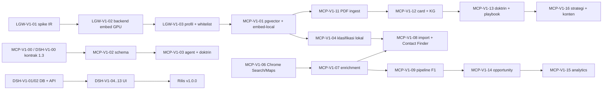

# v1.0.0 — Marketing Intelligence Platform (Ringkasan Lintas Repo)

> **Status:** Draf brainstorming rev. 2 · 9 November 2026
> **Sumber:** `../../../blueprint_marketing_intelligence_platform.md` + kondisi kode ketiga repo + keputusan brainstorming 9 Nov 2026.
> Dokumen ini adalah **hub** v1.0.0. Task per repo:
> - MCP → [TASKS.md](TASKS.md) (ID `MCP-V1-xx`)
> - Dashboard → `marketingdashboardjtp/Documentation/v1.0.0/V1_TASKS.md` (ID `DSH-V1-xx`)
> - LLM Gateway → `llm-genai/docs/v1.0.0/V1_TASKS.md` (ID `LGW-V1-xx`)

---

## 1. Tujuan v1.0.0

Dashboard menjadi alat kerja yang **bisa dipakai sehari-hari dan menghasilkan insight**. Enam alur:

| # | Alur | Ringkas |
|---|---|---|
| F1 | **Company Discovery** | Produk kita → industri & segmen yang membutuhkan → cari perusahaan via **Google Search/Maps di Chrome** → kunjungi website → profil, kontak, email, alamat, **lat/lng** → vector DB + DB |
| F1b | **Import & Contact Finder** | Upload XLSX/CSV (mis. daftar instansi: nama + alamat) → **agent menormalisasi kolom** → insert DB → (opsional) cari website & kontak tiap baris |
| F2 | **Social Listening** | Produk → ekspansi kata kunci → crawl X/Threads/Trends → vector DB → sentimen per aspek, tema, market signal → DB |
| F3 | **Intelligence & Opportunity** | Market/Company Intelligence, product-fit, scoring yang bisa diaudit, Opportunity Center & Map, Executive Overview |
| F4 | **Knowledge Engine** | Upload PDF buku marketing (≤ 100 MB) → chunk → embedding lokal **Qwen3-Embedding-0.6B (OpenVINO, GPU)** → knowledge card → **knowledge graph** → **doktrin** yang melekat di sistem |
| F5 | **Strategi & Bank Konten** | Analyst + Strategist + Creative memakai doktrin buku + data → strategi digital marketing & **bank konten medsos** yang kreatif, bersitasi, direview manusia |

Alur nilai (blueprint §1): **Data Collection → Market Intelligence → Opportunity Discovery → Marketing Strategy → Business Action**.

## 2. Titik berangkat (kondisi kode 9 Nov 2026)

| Area | Sudah ada | Celah v1.0.0 |
|---|---|---|
| Scraping web | `web_scrape/crawl/extract` (Selenium, SSRF/robots, profil browser) | Belum ada discovery (Google Search/Maps), ekstraksi kontak/alamat, geocoding, import file |
| Sosial | `x_search`, `threads_search`, `trends_*`, `sentiment_*`, pipeline `intel` | Input masih keyword; model sentimen lokal **belum dipilih** (fallback LLM); belum ada aspek/tema/sinyal |
| KB | `kb_*`, chunker, hybrid RRF, koleksi `intel:<ws>` | pgvector belum terpasang (mode cadangan ≤ 20.000 chunk); HNSW hanya 384/1536; tanpa ingest PDF & KG |
| Gateway | `/v1/embeddings` + fallback, runtime OpenVINO (LLM/VLM/diffusion) | Profil `remote-only`; **tidak ada backend embedding lokal**; `local_runtime_provider` belum melayani embedding |
| Agent | `researcher`, `analyst`, `strategist` (+ key Gateway `system`) | Belum ada agent konten, kurator pengetahuan, prospek perusahaan; belum ada doktrin |
| Dashboard | Modul 1 (PM), 2 (web report), 3 (Intel job, misi, 3D KB) | Belum ada katalog produk, company DB + peta, import, opportunity, strategy studio, bank konten, knowledge library, KPI |

## 3. Keputusan (dikunci 9 Nov 2026)

| # | Topik | Keputusan |
|---|---|---|
| V1-K1 | Target pengguna | Internal, isolasi per workspace (RBAC yang ada) |
| V1-K2 | Produk dianalisis | Produk milik sendiri, katalog per workspace |
| V1-K3 | Kepemilikan data | **Dashboard (`public`)** = yang ditulis/dikurasi manusia: produk, opportunity workflow, aksi, approval, strategi, **bank konten**, metadata upload. **MCP (`mcp`)** = yang dikumpulkan/dihitung mesin: perusahaan, kontak, kebutuhan, sinyal, provenance, import batch, skor, KB, KG, doktrin, playbook. Dashboard membaca data MCP **lewat tool MCP**; MCP membaca `public.products` lewat read model |
| V1-K4 | Sumber pencarian | **Hanya Google Chrome** (Selenium + profil browser): Google Search dan **Google Maps volume rendah**. Tanpa API berbayar. CAPTCHA → job **pause** + notifikasi, diselesaikan manual (tidak diakali) |
| V1-K5 | Geocoding | JSON-LD/`geo` di website → Google Maps (Chrome) → **Nominatim/OSM** (gratis, ≤ 1 req/s, cache) → tandai presisi |
| V1-K6 | Kontak & UU PDP | Hanya kontak yang dipublikasikan sendiri oleh perusahaan/instansi; `generic` vs `personal`; personal wajib review; suppression list; tanpa tebak email/SMTP probe; provenance wajib |
| V1-K7 | Model lokal | **Satu-satunya model runtime lokal: `Qwen/Qwen3-Embedding-0.6B`** (≙ tag `qwen3-embedding:0.6b`) sebagai **OpenVINO IR di GPU**, 1024 dim, route `embed-local`. Model lokal lain tetap nonaktif, **tidak di-compile & tidak dimuat** (whitelist runtime). Tanpa Ollama. Tidak boleh jatuh ke CPU |
| V1-K8 | Koleksi vector | Koleksi 1024-dim `embed-local`: `books:<ws>`, `companies:<ws>`, `social:<ws>`. Koleksi 1536 lama tetap. **pgvector wajib** |
| V1-K9 | Upload | Dashboard stream-proxy ke MCP `POST /uploads`: PDF ≤ 100 MB; XLSX/CSV ≤ 20 MB / 50.000 baris. Ekstraksi PDF `pypdf`/`pdfplumber`; halaman scan → `needs_ocr` (OCR = P2) |
| V1-K10 | Knowledge graph | Relasional di `mcp` (`kg_nodes`, `kg_edges`, `kg_chunk_links`), mencakup **semua koleksi** (buku, perusahaan, sosial), bukan hanya buku |
| V1-K11 | Knowledge "melekat" | **Melekat di sistem, bukan di bobot model.** L1 RAG · L2 **doktrin per peran** (selalu disuntikkan ke prompt) · L3 graf terikat ke data · L4 playbook · L5 evaluator rubrik. Fine-tuning di luar v1 |
| V1-K12 | Pemrosesan | **Local-first**: volume tinggi (mapping kolom, KBLI/ISIC, kontak, dedupe, sentimen, tema, product-fit) dikerjakan embedding lokal + aturan deterministik. LLM remote hanya untuk tugas generatif bernilai tinggi. **"LLM assist"** (gpt-5-mini) opsional per job, default **mati**, hanya untuk baris ber-confidence rendah |
| V1-K13 | Route LLM remote | `smart` = gpt-5 (analisis produk, ekstraksi pengetahuan buku, strategi) · `creative` = Claude Sonnet 5.5 → gpt-5 (bank konten) · `extract` = gpt-5-mini (hanya saat LLM assist) |
| V1-K14 | Taksonomi & wilayah | **KBLI 2020 + ISIC Rev.4** (satu tabel + mapping). Wilayah **Indonesia**, kode wilayah Kemendagri (provinsi, kab/kota) |
| V1-K15 | Fungsi buku | Pengetahuan untuk **Analyst, Strategist, Creative** agar strategi digital marketing & bank konten kreatif tetapi berpijak pada buku. Cek orisinalitas embedding (draf terlalu mirip teks buku ditolak) |
| V1-K16 | Bank konten | Platform: Instagram, TikTok, LinkedIn, X, Threads. Bahasa Indonesia. Brief visual teks (generator gambar di luar v1). Publish manual |
| V1-K17 | Agent | Lama: `researcher`, `analyst`, `strategist`. **Baru: `creative`, `curator`, `prospector`** (nama Inggris). Satu key Gateway per agent |
| V1-K18 | Orkestrasi | Jenis job `intel` baru: `company_discovery`, `company_import`, `contact_finder`, `social_listening`, `book_ingest`, `opportunity_scoring`, `strategy`, `content_bank`. **Kontrak 1.3** (aditif) |
| V1-K19 | Human-in-the-loop | v1 tidak mengirim komunikasi keluar. Won/lost, approve strategi, knowledge card, kontak personal, dan konten = manusia |
| V1-K20 | Library Dashboard | **MapLibre GL** (tile OSM, atribusi) & **react-force-graph** — disetujui |
| V1-K21 | Rilis | Tag **v1.0.0** di tiap repo setelah task V1 selesai **dan** E2E lintas repo F1–F5 lulus |

### Masih terbuka
1. Daftar instansi (jumlah baris) — menyusul; menentukan estimasi waktu Contact Finder.
2. Dokumen brand guideline (bila ada) → di-upload sebagai aset jenis `brand`.
3. `ANTHROPIC_API_KEY` untuk route `creative` (tanpa key → route jatuh ke gpt-5).
4. Plafon budget bulanan Gateway — usul $150/bulan untuk project `marketing-mcp`.

## 4. Agent

| Agent | Status | Route | Tugas v1 | Doktrin buku |
|---|---|---|---|---|
| `researcher` | ada, diperluas | smart | Social listening product-centric, kata kunci, koleksi X/Threads/Trends | — |
| `analyst` | ada, diperluas | smart | Analisis produk → industri/segmen, bukti product-fit, ringkasan insight, playbook analisis | segmentasi, riset pasar, metrik |
| `strategist` | ada, diperluas | smart | Strategi digital marketing, positioning, funnel, channel mix, content pillar → **content brief** | positioning, funnel, channel mix, pillar |
| `creative` | **baru** | creative | Bank konten: ide, hook, caption, CTA, hashtag, brief visual; variasi → evaluasi rubrik | copywriting, hook, persuasi, format per platform, brand |
| `curator` | **baru** | smart | Knowledge card, kanonikalisasi KG, ringkasan doktrin per peran — **setia teks, tidak kreatif** | (pembuat doktrin) |
| `prospector` | **baru** | extract (lokal default) | Mapping kolom import, discovery, Contact Finder, enrichment; satu-satunya agent yang menulis perusahaan & kontak | ICP/segmen dari analyst |

Bukan agent: scoring engine, normalisasi, geocoding, dedupe, klasifikasi lokal, evaluator (langkah internal), planner misi (sudah ada).

## 5. Arsitektur Alur

### F1 — Company Discovery (`company_discovery`)
```text
Produk + wilayah (Indonesia/provinsi) + batas
 → analyst   product_analysis : kandidat industri diperingkat lokal (embedding produk ↔ deskripsi KBLI)
                                → LLM smart menyaring, memberi alasan, segmen & query → [review]
 → prospector discovery       : Google Search + Google Maps (Chrome, volume rendah, cache, pause saat CAPTCHA)
 → prospector enrichment      : crawl website (≤ 8 halaman) → JSON-LD/regex/listing Maps → normalisasi
                                → kontak generic/personal → geocode → KBLI/ISIC (lokal) → kebutuhan (ekstraktif)
 → sistem     index           : chunk → companies:<ws> (embed-local) + tautan chunk↔node KG
 → analyst/engine fit & score : kemiripan kebutuhan↔fitur (lokal) + scoring deterministik
```

### F1b — Import & Contact Finder (`company_import` → `contact_finder`)
```text
Upload XLSX/CSV → profiling (header, 20 baris, tipe)
 → prospector mapping kolom   : pola nilai + embedding header ↔ deskripsi field (LLM assist bila ragu)
 → normalisasi deterministik  : wilayah Kemendagri, telepon, dedupe (trigram + embedding)
 → klasifikasi lokal          : sektor → KBLI 2020 + ISIC
 → insert (import_batch, bisa rollback); baris ragu → antrean review (tidak memblokir)
 → Contact Finder per baris   : Google Maps "nama + alamat" → website/telepon/koordinat
                                → tanpa website? Google Search → verifikasi domain (.ac.id/.sch.id/.go.id/.co.id)
                                → crawl kontak → status found / ambiguous / not_found / needs_hint
```

### F2 — Social Listening (`social_listening`)
Produk → `researcher` ekspansi kata kunci (+ `trends_related`) → review → X/Threads/Trends → `social:<ws>` → sentimen **classifier lokal** (embedding + head terlatih) per aspek fitur → klaster tema (lokal) → market signal → `analyst` ringkasan & laporan.

### F4 — Knowledge Engine (`book_ingest`)
Upload → halaman + outline → chunk semantik (bab/subbab/halaman) → `embed-local` (GPU) → `books:<ws>` → `curator`: knowledge card per jenis (framework strategi, prinsip persuasi, formula copywriting, format konten, taktik channel, KPI, anti-pola) → review manusia → KG → **doktrin per peran** (±1.500 token, di-cache).

### F5 — Strategi & Bank Konten (`strategy` → `content_bank`)
```text
Doktrin buku (cara) + data (produk, segmen, tema, pain point, sentimen, kompetitor, tren)
 → analyst    insight
 → strategist strategi digital marketing + content brief (pillar, funnel, platform, KPI)
 → creative   banyak variasi ide (divergen) → evaluator rubrik buku (konvergen)
              → cek orisinalitas (kosinus ke chunk buku > 0,9 → buat ulang)
 → bank konten (Dashboard): review → kalender → task Penjadwalan → publish manual
```

## 6. Rencana Database (ringkas)

**MCP** — `0005_market_intel`, `0006_knowledge`, `0007_opportunity`:
`regions`, `industries` (+ `industry_isic_map`), `product_analyses`, `segments`, `companies`, `company_domains`, `company_locations`, `contacts`, `contact_suppressions`, `company_needs`, `market_signals`, `source_records`, `company_snapshots`, `import_batches`, `import_rows`, `contact_finder_targets`, `geocode_cache`, `search_cache`, `local_classifiers`; `knowledge_assets`, `knowledge_pages`, `knowledge_cards`, `kg_nodes`, `kg_edges`, `kg_chunk_links`, `agent_doctrines`, `agent_playbooks`, `playbook_runs`; `scoring_models`, `product_fits`, `opportunity_scores`, `kpi_definitions`, `content_generation_runs`; HNSW 1024.

**Dashboard** — Prisma `m4_market_intel`:
`products`, `product_features`, `opportunities`, `opportunity_events`, `marketing_actions`, `strategy_docs`, `content_items`, `approvals`, `upload_refs`, `saved_views`.

**Gateway** — migrasi `0005_usage_tags` (tag usage per job); model/route/profil lewat `seed_models.yaml` & Admin API.

## 7. Estimasi Biaya LLM Remote (sementara)

Harga dari `llm-genai/scripts/seed_models.yaml` (USD/1 jt token in/out): gpt-5 1,25/10 · gpt-5-mini 0,25/2 · Claude Sonnet 5.5 2/10. Kurs asumsi Rp16.500. Embedding lokal, Chrome/Maps, Nominatim = $0.

| Pekerjaan | Route | Estimasi |
|---|---|---|
| Analisis produk | smart | ~$0,05 / analisis |
| Import, KBLI/ISIC, Contact Finder, enrichment, sentimen, tema, product-fit | lokal | $0 (LLM assist: +~$3–6 / 1.000 baris) |
| Ingest buku 500 hlm (card, KG, doktrin) | smart | ~$2–4 / buku, sekali |
| Ringkasan social listening | smart | ~$0,1 / job |
| Strategi | smart | ~$0,1–0,2 / strategi |
| Bank konten (30 ide + evaluasi) | creative | ~$0,15–0,3 / batch |
| Agent/misi harian + doktrin (prompt caching) | campuran | ~$10–20 / bulan |
| **Bulan pertama** (5 buku + isi awal) | | **~$30–40 (≈ Rp0,5–0,7 jt)** |
| **Bulan berikutnya** | | **~$10–25 (≈ Rp0,2–0,4 jt)** |

Cadangan ×1,5 untuk retry & variasi token reasoning. Kalibrasi dengan **pilot 20 instansi + 1 buku** memakai laporan biaya per job (LGW-V1-06).

## 8. Urutan Lintas Repo & Task Pertama



**Mulai paralel minggu pertama:**

| Repo | Kerjakan dulu | Alasan |
|---|---|---|
| **llm-genai** | **LGW-V1-01** spike ekspor Qwen3-Embedding-0.6B → OpenVINO IR + uji kesetaraan & memori GPU → **LGW-V1-02** backend `openvino_embed` → **LGW-V1-03** profil `remote-embed-gpu` + whitelist | Risiko teknis terbesar (dukungan arsitektur Qwen3 di OpenVINO belum terverifikasi) dan memblokir semua embedding 1024 |
| **mcp** | **MCP-V1-00** kontrak 1.3 → **MCP-V1-02** schema → **MCP-V1-01** pasang pgvector (bagian instalasi tidak perlu menunggu Gateway) → **MCP-V1-06** spike Chrome Search/Maps | Schema & kontrak memblokir Dashboard; pgvector prasyarat buku; spike Chrome mengukur laju & CAPTCHA nyata |
| **marketingdashboardjtp** | **DSH-V1-00** kontrak → **DSH-V1-03** UI/UX → **DSH-V1-01** DB Prisma → **DSH-V1-02** API (dengan mock MCP) | Tidak perlu menunggu fitur MCP selesai; mock MCP Modul 3 sudah ada |

Fase berikutnya: F1b (import + Contact Finder, karena data instansi sudah ada) dan F4 (buku) → F1 → F2 → F3 → F5 → evaluasi & rilis.

## 9. Kriteria Rilis v1.0.0
1. **F1:** 1 produk → ≥ 50 perusahaan di 1 provinsi; ≥ 80% website valid; ≥ 70% lat/lng presisi ≥ `city`; setiap field punya provenance.
2. **F1b:** file instansi (nama + alamat) ter-import dengan mapping otomatis, ≥ 95% baris ternormalisasi wilayahnya; Contact Finder menghasilkan status per baris dan kontak bersumber.
3. **F2:** laporan sentimen per aspek + ≥ 5 tema + market signal tertaut ke post; classifier lokal macro-F1 ≥ 0,80.
4. **F3:** setiap opportunity menampilkan komponen skor, bobot, bukti, info kurang, confidence, versi model.
5. **F4:** PDF ≤ 100 MB ter-ingest lewat `embed-local` di **GPU**; sitasi halaman benar; KG dapat dijelajahi; doktrin aktif di prompt agent.
6. **F5:** strategi + bank konten 30 item: setiap item tertaut ke prinsip buku (halaman) & insight data, lolos cek orisinalitas, direview manusia.
7. Runtime Gateway hanya memuat Qwen3-Embedding (diverifikasi dari `/health`); tidak ada model lain ter-compile.
8. Tidak ada secret/kontak personal belum-review bocor ke ekspor, log, atau respons API. Contract test 1.3 hijau di kedua repo; E2E stack nyata lulus.

## 10. Risiko Utama
| Risiko | Mitigasi |
|---|---|
| OpenVINO belum mendukung ekspor/arsitektur Qwen3-Embedding dengan baik | Spike LGW-V1-01 di hari pertama; alternatif jalur `optimum-intel` vs OpenVINO GenAI `TextEmbeddingPipeline`; uji kesetaraan kosinus ≥ 0,99 |
| Satu model embedding di satu iGPU melayani semua beban | Antrean berprioritas (`interactive` > `bulk`), batch, benchmark LGW-V1-05 |
| CAPTCHA/blokir Google Search & Maps | Volume rendah, jeda acak, cache, pause + selesai manual; perkiraan waktu dalam hari, bukan menit |
| ToS Google Maps | Volume rendah, hanya data listing publik, risiko diterima pemilik produk (keputusan 9 Nov 2026) |
| Kualitas pemrosesan lokal (kutipan vs ringkasan, sarkasme di sentimen) | Gerbang evaluasi; LLM assist opsional untuk baris ber-confidence rendah |
| Prompt injection dari konten scraping | Ekstraksi tanpa tools, konten dibungkus sebagai data, output divalidasi schema |
| Hak cipta buku | Akses per workspace, potongan ≤ 600 karakter + sitasi, cek orisinalitas konten |
| UU PDP | V1-K6, suppression list, retensi, review kontak personal |
